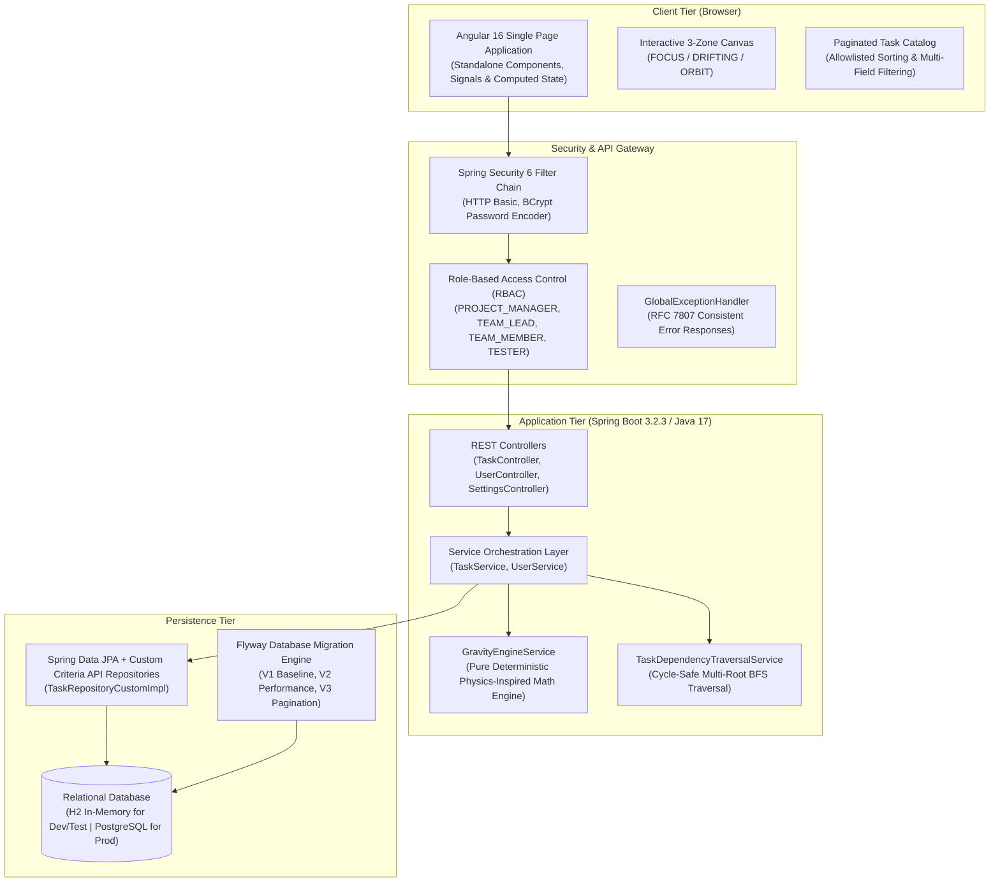
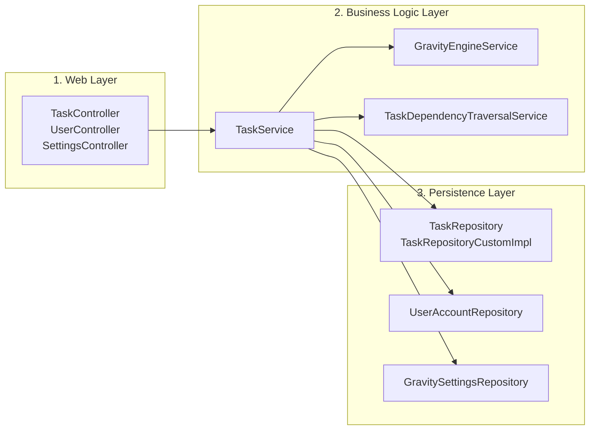
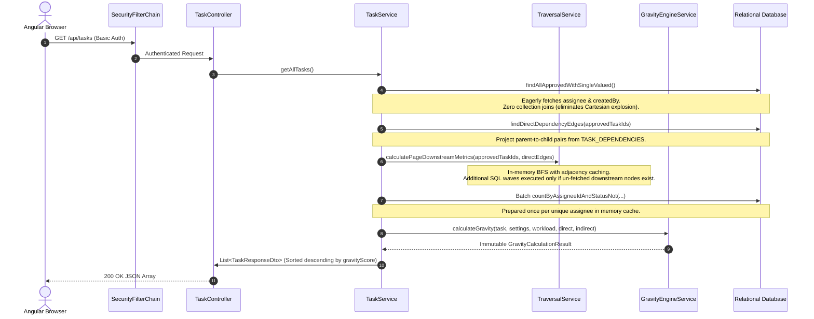

# Priora Architecture Documentation

## 1. System Topology Overview

Priora is an enterprise-grade task prioritization and dependency canvas engine built on a decoupled, three-tier architecture:



---

## 2. Angular 16 Frontend Architecture

The frontend is constructed using modern Angular 16 architecture adhering strictly to corporate enterprise standards (zero emojis, accessible light-mode palette with Tailwind CSS).

### 2.1 Standalone Component Design
All components declare `standalone: true`, eliminating legacy `NgModule` boilerplate and enabling tree-shakable lazy routing:
- **`CanvasComponent`**: Renders the 3-tier orbital prioritization canvas (`FOCUS`, `DRIFTING`, `ORBIT`).
- **`TaskCardComponent`**: Encapsulates card-level telemetry (blast radius, deadline countdown, stagnation timer, assignee workload chip, and blocker ping toggle).
- **`ApprovalsComponent`**: Dedicated review queue for `ROLE_PROJECT_MANAGER` and `ROLE_TEAM_LEAD` to inspect, approve, or reject developer tickets with reason logging.
- **`UserManagementComponent`**: Administrative roster for creating team member accounts with whitelisted roles.
- **`SettingsComponent`**: Real-time slider and toggle dashboard to modify Gravity Engine mathematical parameters and custom factor weights.

### 2.2 Reactive State Management with Signals
Angular Signals (`signal`, `computed`) manage all reactive state in `AuthService`, `TaskService`, and `SettingsService`:
```typescript
// TaskService reactive state
public tasks = signal<Task[]>([]);
public pendingTasks = signal<Task[]>([]);
public loading = signal<boolean>(false);
public errorMessage = signal<string | null>(null);

// Pure computed signals driving the 3-Zone Canvas
public focusZoneTasks = computed(() => 
  this.tasks().filter(t => t.canvasZone === 'FOCUS')
);
public driftingZoneTasks = computed(() => 
  this.tasks().filter(t => t.canvasZone === 'DRIFTING')
);
public orbitZoneTasks = computed(() => 
  this.tasks().filter(t => t.canvasZone === 'ORBIT')
);
```

### 2.3 Functional Route Guards
Client-side routing in `app.routes.ts` uses functional router guards:
- **`authGuard`**: Verifies `authService.isAuthenticated()`. Redirects unauthenticated sessions to `/login`.
- **`managerGuard`**: Verifies `authService.isManager()` (`ROLE_PROJECT_MANAGER` or `ROLE_TEAM_LEAD`). Redirects unauthorized users to `/canvas`.
- **`adminGuard`**: Verifies `authService.isAdmin()` (`ROLE_PROJECT_MANAGER`). Restricts user-creation roster access.

---

## 3. Spring Boot Backend Layered Architecture



### 3.1 Separation of Concerns
1. **Web Layer (`com.gravitycanvas.controller`)**: Validates incoming DTOs (`@Valid`), enforces HTTP status codes, handles Swagger OpenAPI annotations, and maps exceptions through `GlobalExceptionHandler`.
2. **Service Orchestration Layer (`com.gravitycanvas.service`)**:
   - `TaskService`: Manages transactional boundaries (`@Transactional`), enforces entity lifecycle transitions, orchestrates approvals, and invokes graph unlinking on task deletion.
   - `UserService`: Enforces OWASP username/password/full-name validation rules and BCrypt credential encoding.
3. **Pure Computational Engine (`GravityEngineService`)**:
   - Encapsulates mathematical formulas with zero HTTP or UI dependencies.
   - Injected with `Clock` for deterministic, millisecond-accurate testing.
4. **Graph Traversal Service (`TaskDependencyTraversalService`)**:
   - Handles multi-root breadth-first search (BFS) graph reachability, outgoing edge caching, and pre-commit cycle detection.
5. **Data Access Layer (`com.gravitycanvas.repository`)**:
   - Combines Spring Data JPA interfaces with a custom Criteria API implementation (`TaskRepositoryCustomImpl`) for dynamic server-side pagination, allowlisted sorting, and 64-bit integer overflow guards.

---

## 4. Request & Response Processing Lifecycles

Priora implements two distinct execution pipelines to serve real-time visual canvas requests and high-volume paginated catalog queries efficiently:

### Pipeline A: Main Canvas Pipeline (`GET /api/tasks`)


### Pipeline B: Paginated Search & Filter Pipeline (`GET /api/tasks/search`)
1. **Stage 1 (ID Extraction & Total Count)**:
   - `TaskRepositoryCustomImpl` executes an optimized Criteria API query selecting only `task.id` matching filters (`status`, `environment`, `assigneeId`, `search`).
   - Applies allowlisted sorting with a deterministic secondary tie-breaker (`ORDER BY ... , id DESC`).
   - Restricts results using `setFirstResult(page * size)` and `setMaxResults(size)`.
   - Executes a parallel count query to populate `PageResponse` metadata (`totalPages`, `totalElements`).
2. **Stage 2 (Root Entity Hydration)**:
   - Hydrates the exact page slice IDs via `findRootEntitiesByIdIn(:ids)` with single-valued joins (`assignee`, `createdBy`).
   - Never loads `dependentTasks` or `dependencies` collections directly, preventing Cartesian product duplication.
3. **Stage 3 (Downstream Metrics & Gravity Scoring)**:
   - Evaluates BFS reachability only for the root tasks on the current page slice.
   - Returns a `PageResponse<TaskResponseDto>` payload.
