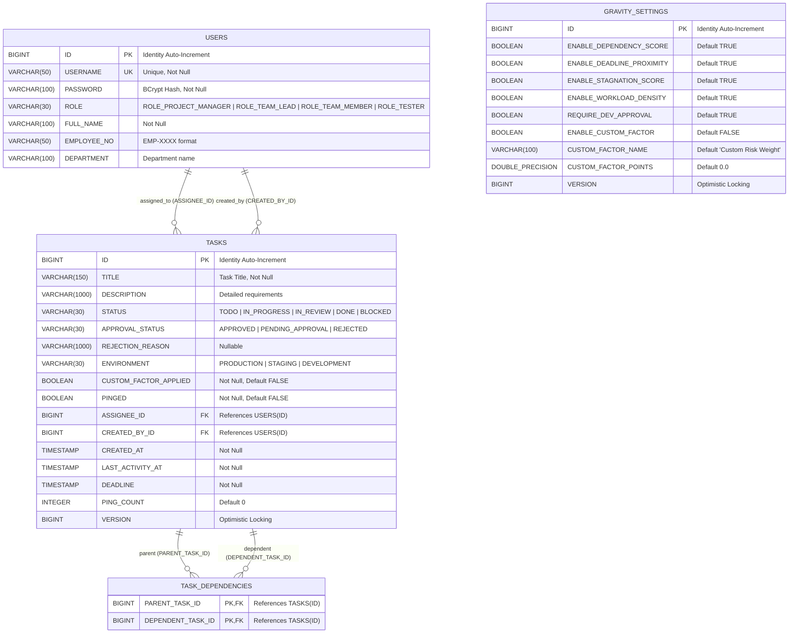

# Priora Database Schema & REST API Reference

This document provides the complete database architecture, Entity-Relationship (ER) model, Flyway migration log, and comprehensive REST API reference for Priora.

---

## 1. Database Entity-Relationship (ER) Diagram



---

## 2. Flyway Database Migrations & Indexing Strategy

Priora enforces strict database schema management using Flyway migrations with Hibernate configured in `validate` mode.

### Migration History

| Version | Migration File | Description | Impacted Tables |
| :---: | :--- | :--- | :--- |
| **`V1`** | `V1__initial_schema.sql` | Baseline portable ANSI SQL schema creation. Establishes primary keys, foreign keys, unique constraints, and initial column structures. | `USERS`, `GRAVITY_SETTINGS`, `TASKS`, `TASK_DEPENDENCIES` |
| **`V2`** | `V2__phase8_performance_indexes.sql` | Introduces high-performance composite B-tree indexes for assignee workload aggregation and reverse dependency navigation. | `TASKS`, `TASK_DEPENDENCIES` |
| **`V3`** | `V3__phase10_pagination_indexes.sql` | Adds composite covering index for Stage 1 root ID extraction and deterministic sorting. | `TASKS` |

### Strategic B-Tree Indexes

1. **`idx_tasks_assignee_status` on `TASKS(ASSIGNEE_ID, STATUS)` (V2)**:
   - Accelerates `taskRepository.countByAssigneeIdAndStatusNot(assigneeId, DONE)` used during Workload Density calculation.
   - The composite index navigates the B-tree with `ASSIGNEE_ID` as the leading column and filters non-DONE status in a single index scan, avoiding full-table scans.
2. **`idx_task_deps_dependent_id` on `TASK_DEPENDENCIES(DEPENDENT_TASK_ID)` (V2)**:
   - Primary key covers `(PARENT_TASK_ID, DEPENDENT_TASK_ID)`. When loading reverse dependencies (`task.getDependencies()`), queries filter by `WHERE DEPENDENT_TASK_ID = ?`. This index prevents full table scans on reverse lookups.
3. **`idx_tasks_approval_created_id` on `TASKS(APPROVAL_STATUS, CREATED_AT DESC, ID DESC)` (V3)**:
   - Covers Stage 1 catalog pagination queries filtering on `APPROVAL_STATUS` and ordering by `CREATED_AT DESC, ID DESC`. Enables index-only scans for high-volume catalogs.

---

## 3. Role-Based Access Control (RBAC) Permission Matrix

Priora defines 4 role tiers enforced at both the Spring Security filter chain and service layer:

| Resource / Endpoint | HTTP Method | `ROLE_PROJECT_MANAGER` | `ROLE_TEAM_LEAD` | `ROLE_TEAM_MEMBER` | `ROLE_TESTER` | Public |
| :--- | :---: | :---: | :---: | :---: | :---: | :---: |
| `/api/users/register` | `POST` | Allowed | Allowed | Allowed | Allowed | **PermitAll** |
| `/api/auth/me` | `GET` | Allowed | Allowed | Allowed | Allowed | Denied |
| `/api/users/change-password` | `PUT` | Allowed | Allowed | Allowed | Allowed | Denied |
| `/api/users` | `GET` | Allowed | Allowed | Allowed | Allowed | Denied |
| `/api/users` | `POST` | **Allowed** | Denied (403) | Denied (403) | Denied (403) | Denied |
| `/api/tasks` | `GET` | Allowed | Allowed | Allowed | Allowed | Denied |
| `/api/tasks/search` | `GET` | Allowed | Allowed | Allowed | Allowed | Denied |
| `/api/tasks` | `POST` | **Allowed** | **Allowed** | Denied (403) | Denied (403) | Denied |
| `/api/tasks/pending` | `GET` | **Allowed** | **Allowed** | Denied (403) | Denied (403) | Denied |
| `/api/tasks/pending/search` | `GET` | **Allowed** | **Allowed** | Denied (403) | Denied (403) | Denied |
| `/api/tasks/*/approve` | `PUT` | **Allowed** | **Allowed** | Denied (403) | Denied (403) | Denied |
| `/api/tasks/*/reject` | `PUT` | **Allowed** | **Allowed** | Denied (403) | Denied (403) | Denied |
| `/api/tasks/**` | `DELETE` | **Allowed** | **Allowed** | Denied (403) | Denied (403) | Denied |
| `/api/tasks/*/deadline` | `PUT` | **Allowed** | **Allowed** | Denied (403) | Denied (403) | Denied |
| `/api/tasks/*/reassign` | `PUT` | **Allowed** | **Allowed** | Denied (403) | Denied (403) | Denied |
| `/api/tasks/*/dependencies` | `PUT` | **Allowed** | **Allowed** | Denied (403) | Denied (403) | Denied |
| `/api/tasks/*/ping` | `POST` | **Allowed** | **Allowed** | Denied (403) | Denied (403) | Denied |
| `/api/tasks/*/status` | `PUT` | Allowed | Allowed | Allowed | Allowed | Denied |
| `/api/settings` | `GET` | Allowed | Allowed | Allowed | Allowed | Denied |
| `/api/settings` | `PUT` | **Allowed** | **Allowed** | Denied (403) | Denied (403) | Denied |

---

## 4. Comprehensive REST API Reference

### 4.1 Authentication & User Management

#### `GET /api/auth/me`
- **Description:** Returns the profile and active role of the authenticated user.
- **Headers:** `Authorization: Basic <base64-credentials>`
- **Response (200 OK):**
  ```json
  {
    "id": 1,
    "username": "project.manager",
    "fullName": "Marcus Vance",
    "role": "ROLE_PROJECT_MANAGER",
    "employeeNo": "EMP-001",
    "department": "Product & Engineering"
  }
  ```

#### `POST /api/users/register`
- **Description:** Public registration endpoint. Always sets role to `ROLE_TEAM_MEMBER` (role field in request body is discarded).
- **Request Body:**
  ```json
  {
    "username": "new.developer",
    "password": "StrongPassword123!",
    "fullName": "Jane Doe",
    "employeeNo": "EMP-205",
    "department": "Platform Services"
  }
  ```
- **Response (201 Created):** `UserResponseDto`

#### `POST /api/users`
- **Description:** Administrative user creation restricted to `ROLE_PROJECT_MANAGER`. Allows assigning explicit roles (`ROLE_TEAM_LEAD`, `ROLE_TEAM_MEMBER`, `ROLE_TESTER`).
- **Response (201 Created):** `UserResponseDto`

#### `PUT /api/users/change-password`
- **Description:** Authenticated user changes their own password. Enforces OWASP password validation.
- **Request Body:**
  ```json
  {
    "oldPassword": "CurrentPassword123!",
    "newPassword": "NewSecurePassword2026!"
  }
  ```
- **Response (200 OK):** Empty body

---

### 4.2 Task Management & Visual Canvas

#### `GET /api/tasks`
- **Description:** Retrieves all approved tasks evaluated with dynamic Gravity Scores, sorted descending by score for the main 3-zone canvas.
- **Response (200 OK):** JSON Array of `TaskResponseDto`
  ```json
  [
    {
      "id": 2,
      "title": "REST API Filter Chain & Role-Based Access Control",
      "description": "Implement Spring Security 6 filter chain...",
      "status": "IN_PROGRESS",
      "approvalStatus": "APPROVED",
      "environment": "STAGING",
      "assignee": { "id": 3, "username": "developer.one", "fullName": "David Chen" },
      "createdBy": { "id": 2, "username": "team.lead", "fullName": "Elena Rostova" },
      "deadline": "2026-11-10T16:00:00",
      "gravityScore": 52.9,
      "canvasZone": "DRIFTING",
      "dependencyScore": 35.0,
      "directDependentCount": 2,
      "indirectDependentCount": 1,
      "deadlineScore": 9.1,
      "hoursRemaining": 47,
      "overdue": false,
      "stagnationScore": 0.0,
      "workloadScore": 4.0,
      "workloadMultiplier": 1.0,
      "environmentMultiplier": 1.2,
      "pinged": true,
      "pingCount": 1,
      "customFactorApplied": false
    }
  ]
  ```

#### `GET /api/tasks/search`
- **Description:** Server-side paginated catalog of approved tasks with multi-field filtering and allowlisted sorting.
- **Query Parameters:**
  - `page` *(int, default: 0)*: 0-based page index.
  - `size` *(int, default: 20)*: Page size (1 to 100).
  - `sortBy` *(string, default: "createdAt")*: Field to sort by (`createdAt`, `deadline`, `status`, `title`, `environment`).
  - `sortDir` / `direction` *(string, default: "desc")*: Sort order (`asc`, `desc`).
  - `status` *(TaskStatus, optional)*: Filter by `TODO`, `IN_PROGRESS`, `IN_REVIEW`, `DONE`, `BLOCKED`.
  - `environment` *(TaskEnvironment, optional)*: Filter by `PRODUCTION`, `STAGING`, `DEVELOPMENT`.
  - `assigneeId` *(long, optional)*: Filter by assignee user ID.
  - `search` *(string, optional)*: Case-insensitive title substring search.
- **Response (200 OK):** `PageResponse<TaskResponseDto>`
  ```json
  {
    "content": [ ... ],
    "pageNumber": 0,
    "pageSize": 20,
    "totalElements": 5,
    "totalPages": 1,
    "first": true,
    "last": true,
    "hasNext": false,
    "hasPrevious": false
  }
  ```

#### `POST /api/tasks`
- **Description:** Creates a task ticket. Requires `ROLE_PROJECT_MANAGER` or `ROLE_TEAM_LEAD`.
- **Request Body:**
  ```json
  {
    "title": "Migrate to Spring Boot 3.3",
    "description": "Upgrade dependencies and test framework compatibility",
    "environment": "DEVELOPMENT",
    "deadline": "2026-11-20T18:00:00",
    "assigneeId": 3,
    "parentTaskIds": [ 2 ]
  }
  ```
- **Response (201 Created):** `TaskResponseDto`

#### `PUT /api/tasks/{id}/dependencies`
- **Description:** Replaces parent dependencies for a task. Enforces pre-commit DAG cycle prevention.
- **Request Body:**
  ```json
  {
    "dependencyIds": [ 1, 2 ]
  }
  ```
- **Response (200 OK):** `TaskResponseDto`
- **Error (400 Bad Request):** If circular dependency is detected.

#### `PUT /api/tasks/{id}/status`
- **Description:** Updates task status. Permitted for all authenticated roles.
- **Request Body:**
  ```json
  {
    "status": "DONE"
  }
  ```
- **Response (200 OK):** `TaskResponseDto` *(Gravity Score updates immediately; if DONE, moves to ORBIT with 0.0 gravity).*

---

### 4.3 Approval Queue & Settings

#### `GET /api/tasks/pending` & `GET /api/tasks/pending/search`
- **Description:** View pending developer tickets awaiting manager approval.
- **Permitted Roles:** `ROLE_PROJECT_MANAGER`, `ROLE_TEAM_LEAD`.

#### `PUT /api/tasks/{id}/approve`
- **Description:** Transitions task from `PENDING_APPROVAL` to `APPROVED`. Task immediately joins the Canvas graph.

#### `PUT /api/tasks/{id}/reject`
- **Description:** Rejects task ticket with required explanatory reason.
- **Request Body:**
  ```json
  {
    "rejectionReason": "Duplicate of ticket #4. Please combine implementation."
  }
  ```

#### `GET /api/settings` & `PUT /api/settings`
- **Description:** Read or update live Gravity Engine mathematical weights and toggles.
- **Request Body (`PUT`):**
  ```json
  {
    "enableDependencyScore": true,
    "enableDeadlineProximity": true,
    "enableStagnationScore": true,
    "enableWorkloadDensity": true,
    "requireDevApproval": true,
    "enableCustomFactor": true,
    "customFactorName": "Executive Release Priority",
    "customFactorPoints": 15.0
  }
  ```
