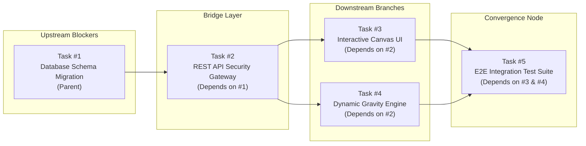
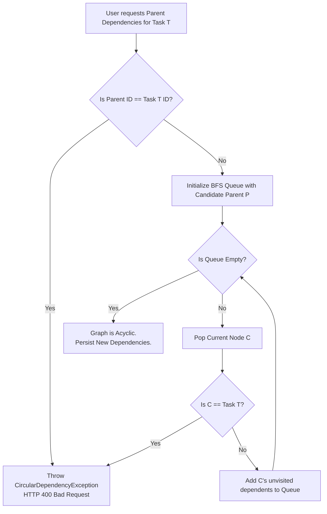
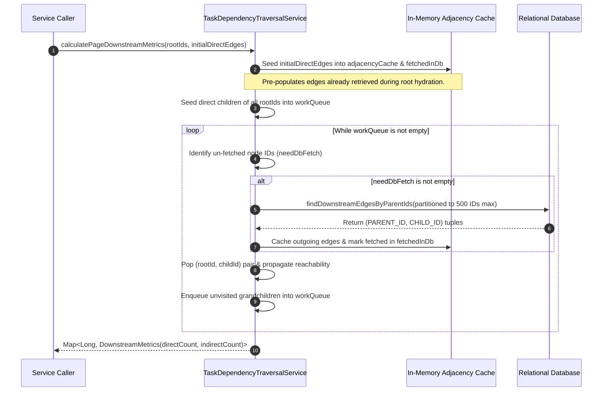

# Priora Dependency Graph & DAG Traversal Architecture

Priora models task dependencies as a **Directed Acyclic Graph (DAG)** to determine blast radius, calculate transitive impact, and prevent deadlock loops across enterprise engineering workflows.

---

## 1. Graph Model & Directionality

In Priora's relational schema (`TASK_DEPENDENCIES`), directed edges point from **upstream blocker (parent)** to **downstream dependent (child)**:

$$\text{Parent Task (Blocker)} \longrightarrow \text{Dependent Task (Blocked Child)}$$



- **Upstream Blockers**: If Task #1 is delayed or blocked, its downstream dependents cannot complete.
- **Blast Radius**: Task #1 blocks 1 direct dependent (#2) and 3 indirect descendants (#3, #4, #5), resulting in a downstream blast radius of 4 tasks.

---

## 2. Pre-Commit DAG Cycle Prevention

Before persisting any dependency modification in `TaskService.updateDependencies()`, Priora validates that the requested links will not introduce a cycle ($A \to B \to \dots \to A$) or self-dependency ($A \to A$).

### 2.1 Cycle Detection Algorithm


1. **Self-Edge Rejection**: Directly rejects requests where a task depends on itself.
2. **Downstream Reachability Check (`isDownstream`)**: Executes an in-memory breadth-first search from the candidate parent. If the target task $T$ is discovered anywhere in the downstream reachability graph of $P$, adding an edge $P \to T$ would create a cycle.
3. **Transactional Safety**: If a cycle is detected, the transaction immediately rolls back and throws `CircularDependencyException`, which `GlobalExceptionHandler` translates to a clean HTTP 400 Bad Request response:
   ```json
   {
     "status": 400,
     "error": "Bad Request",
     "message": "Circular dependency detected: Task cannot depend on its own downstream descendants."
   }
   ```

---

## 3. Multi-Root BFS Traversal Pipeline

When computing downstream metrics for multiple tasks (e.g., rendering the 3-Zone Canvas or generating a paginated catalog page), naive traversal causes the $N+1$ query problem. Priora implements a multi-root BFS traversal pipeline in `TaskDependencyTraversalService`:

### 3.1 Pipeline Execution Flow


### 3.2 Outgoing Adjacency Caching & Query Bounding
1. **Initial Edge Pre-fetching**:
   - For the Canvas, `taskRepository.findDirectDependencyEdges(approvedTaskIds)` fetches all parent/child relationships involving approved tasks in a single native SQL query.
   - These edges are seeded directly into `adjacencyCache` and `fetchedInDb`.
2. **Deep Chain Query Scaling**:
   - **Internal Subgraphs ($W_{\text{transitive}} = 0$)**: When all nodes in a deep dependency chain (e.g. $A \to B \to C \to D \to E$) are part of the initial root set, all edges are already cached. The multi-root propagation loop executes purely in memory with **zero additional database queries**.
   - **External Downstream Descendants ($W_{\text{transitive}} > 0$)**: When dependency chains extend to nodes outside the initial set (e.g., unapproved tasks or tasks on subsequent catalog pages), the algorithm batches all un-fetched nodes at that BFS frontier level into a single query (`findDownstreamEdgesByParentIds`). Each database wave queries all frontier nodes simultaneously rather than issuing individual per-node queries.
3. **Safe Parameter Partitioning**:
   - Database engines (such as Oracle with 1,000-item limits or PostgreSQL parameter ceilings) fail when `IN (:ids)` contains thousands of parameters.
   - `TaskDependencyTraversalService` automatically partitions frontier lookups into chunks of at most 500 IDs using `partitionList(needDbFetch, 500)`.

---

## 4. Two-Stage Server-Side Pagination Architecture

To prevent memory saturation and Hibernate Cartesian product multiplication when browsing large task catalogs, `GET /api/tasks/search` uses a two-stage decoupled pagination architecture:

```mermaid
graph TD
    subgraph Stage1 ["Stage 1: Filtered ID Extraction"]
        Req[GET /api/tasks/search?page=0&size=20&sortBy=deadline] --> Criteria[Criteria API Query]
        Criteria --> CountQ[SELECT COUNT(t.id) FROM Task t WHERE ... ]
        Criteria --> IdQ[SELECT t.id FROM Task t WHERE ... ORDER BY deadline DESC, id DESC]
        IdQ --> PageSlice[Extract exact slice: List<Long> pageIds (max 20)]
    end

    subgraph Stage2 ["Stage 2: Single-Valued Entity Hydration"]
        PageSlice --> Hydrate[SELECT t FROM Task t LEFT JOIN FETCH t.assignee LEFT JOIN FETCH t.createdBy WHERE t.id IN (:pageIds)]
        Hydrate --> NoBags[Zero Collection Joins<br/>(No MultipleBagFetchException, No Row Duplication)]
    end

    subgraph Stage3 ["Stage 3: Targeted Graph Traversal"]
        NoBags --> EdgeProj[Project Direct Edges for pageIds]
        EdgeProj --> BFSPage[calculatePageDownstreamMetrics(pageIds, edges)]
        BFSPage --> GravityScore[Evaluate Gravity for 20 page tasks only]
        GravityScore --> Resp[PageResponse<TaskResponseDto>]
    end
```

### 4.1 Benefits of Two-Stage Decoupling
1. **Elimination of Cartesian Row Multiplication**: Joining two `@ManyToMany` collections (`dependencies` and `dependentTasks`) simultaneously produces $M \times N$ duplicate rows per task in JDBC result sets. Hydrating only root entities with single-valued user relationships (`assignee`, `createdBy`) eliminates this entirely.
2. **Allowlisted Sorting with Tie-Breaker**: Sort fields are strictly validated against an allowlist (`createdAt`, `deadline`, `status`, `title`, `environment`). A secondary deterministic tie-breaker (`id DESC`) guarantees stable page boundaries across pagination requests.
3. **64-bit Integer Offset Protection**: Rejects `page * size > Integer.MAX_VALUE` before passing to JPA, protecting against integer overflow attacks.
