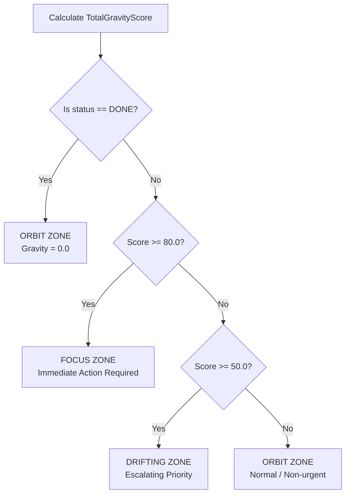

# Priora Gravity Engine — Mathematical & Algorithmic Specification

The **Priora Gravity Engine** is a deterministic, continuous scoring system inspired by gravitational mechanics. Unlike arbitrary low/medium/high priority tags, Gravity continuously computes a dynamic numerical score for every task based on downstream blast radius, deadline proximity, activity stagnation, assignee bottlenecks, and operational environment.

---

## 1. Master Formula Architecture

The total gravity score is evaluated in two phases: base score accumulation followed by compound multipliers:

$$\text{BaseScore} = S_{\text{blast}} + S_{\text{deadline}} + S_{\text{stagnation}} + S_{\text{blocker}} + S_{\text{custom}}$$

$$\text{TotalGravityScore} = \text{round}_{1\text{dp}}\Big(\text{BaseScore} \times M_{\text{workload}} \times M_{\text{environment}}\Big)$$

All calculations in `GravityEngineService.java` are deterministic and verified against fixed-time golden value suites using injected `java.time.Clock` instances.

---

## 2. Mathematical Component Breakdown

### 2.1 Downstream Blast Radius ($S_{\text{blast}}$)
Quantifies the impact if this task is delayed. A task that blocks many downstream tasks creates compounding team latency.
- Direct dependents are weighted linearly (+15.0 pts each).
- Indirect/transitive descendants are weighted logarithmically to prevent mega-epics from skewing priority scales:

$$S_{\text{blast}} = \Big(\text{directCount} \times 15.0\Big) + \left(5.0 \times \frac{\ln(1 + \text{indirectCount})}{\ln(2.0)}\right)$$

- **Controlled by Toggle:** `GravitySettings.enableDependencyScore` (default: `true`).

---

### 2.2 Deadline Proximity & Overdue Escalation ($S_{\text{deadline}}$)
Evaluates urgency based on the number of hours remaining until the deadline ($h_{\text{remaining}}$). Implemented via a two-phase function:

#### Phase 1: Approaching Deadline ($h_{\text{remaining}} > 0$)
Uses a logistic sigmoid S-curve centered at 24 hours ($x_0 = 24.0$) with steepness $k = 0.1$:

$$S_{\text{deadline}} = \frac{100.0}{1.0 + \exp\Big(0.1 \times (h_{\text{remaining}} - 24.0)\Big)}$$

- At 72 hours out: $\approx 0.8\text{ pts}$ (minimal gravity).
- At 24 hours out: $\mathbf{50.0\text{ pts}}$ (sigmoid inflection point).
- At 1 hour out: $\approx 89.9\text{ pts}$ (rapid escalation).

#### Phase 2: Overdue Escalation ($h_{\text{remaining}} \le 0$)
When a task crosses its deadline, it jumps immediately to the base overdue floor of $100.0\text{ pts}$ and escalates linearly by $+1.0\text{ pt}$ per hour overdue, capped at $+30.0\text{ pts}$ max:

$$h_{\text{overdue}} = |h_{\text{remaining}}|$$

$$S_{\text{deadline}} = 100.0 + \min\Big(30.0,\; h_{\text{overdue}} \times 1.0\Big)$$

- Total deadline urgency score ranges from **$0.0$ to $130.0\text{ pts}$ max**.
- **Controlled by Toggle:** `GravitySettings.enableDeadlineProximity` (default: `true`).

---

### 2.3 Inactivity Stagnation Aging ($S_{\text{stagnation}}$)
Prevents tickets from lingering silently in `TODO` or `IN_PROGRESS` without updates.
- Computes time since `lastActivityAt` (or `createdAt` if no updates have occurred) in days ($d_{\text{inactive}}$).
- Increases linearly at a rate of $+5.0\text{ pts}$ per 7 days of inactivity, capped at **$15.0\text{ pts}$ maximum** (reached after 21 days):

$$S_{\text{stagnation}} = \min\left(15.0,\; \frac{d_{\text{inactive}}}{7.0} \times 5.0\right)$$

- **Lifecycle Exclusions:** Stagnation aging is automatically **disabled (0.0 pts)** if the task status is:
  - `IN_REVIEW` (actively undergoing peer or QA review).
  - `DONE` (completed).
- **Controlled by Toggle:** `GravitySettings.enableStagnationScore` (default: `true`).

---

### 2.4 Instant Blocker Penalty ($S_{\text{blocker}}$)
When team members mark a task status as `BLOCKED`, the engine immediately injects an emergency constant penalty:

$$S_{\text{blocker}} = \begin{cases} 25.0 & \text{if } \text{status} == \text{BLOCKED} \\ 0.0 & \text{otherwise} \end{cases}$$

---

### 2.5 Assignee Workload Multiplier ($M_{\text{workload}}$)
Accounts for team member capacity and context switching bottlenecks.
- Counts active tasks assigned to the assignee ($W_{\text{active}}$ where $\text{status} \ne \text{DONE}$).
- Applies a baseline capacity threshold of 3 concurrent tasks:

$$M_{\text{workload}} = 1.0 + \Big(0.05 \times \max(0,\; W_{\text{active}} - 3)\Big)$$

- If an assignee has $\le 3$ active tasks: $M_{\text{workload}} = 1.0$ (no penalty).
- If an assignee has 7 active tasks: $M_{\text{workload}} = 1.0 + (0.05 \times 4) = \mathbf{1.20\times}$ (+20% compound gravity).
- Assignee workload density display chip: $S_{\text{workload\_display}} = W_{\text{active}} \times 2.0\text{ pts}$.
- **Controlled by Toggle:** `GravitySettings.enableWorkloadDensity` (default: `true`).

---

### 2.6 Deployment Environment Multiplier ($M_{\text{environment}}$)
Scales overall urgency based on the operational blast radius of the target infrastructure:

| Environment | Multiplier ($M_{\text{environment}}$) | Description |
| :--- | :---: | :--- |
| **`PRODUCTION`** | **$1.5\times$** | Live customer-facing services and production regressions. |
| **`STAGING`** | **$1.2\times$** | Pre-release validation and integration staging clusters. |
| **`DEVELOPMENT`** | **$1.0\times$** | Local development and feature branch work. |

---

### 2.7 Custom Factor Score ($S_{\text{custom}}$)
Allows Project Managers to introduce ad-hoc project risk factors (e.g. "Security Audit Blocker", "Executive Milestone") via the Settings dashboard:
- Configured with a custom name (`customFactorName`) and custom point value (`customFactorPoints`).
- If enabled globally and toggled on an individual task (`task.customFactorApplied == true`):

$$S_{\text{custom}} = \text{settings.getCustomFactorPoints()}$$

---

## 3. Canvas Zones & Classification Thresholds

Tasks are dynamically placed into visual orbital zones on the interactive canvas:

| Zone | Score Range | Operational Meaning |
| :--- | :---: | :--- |
| **`FOCUS`** | $\ge \mathbf{80.0}$ | **Critical Priority.** Immediate intervention required. Overdue milestones, critical blockers, or heavy production dependencies. |
| **`DRIFTING`** | $\mathbf{50.0} \le S < \mathbf{80.0}$ | **Escalating Priority.** Nearing deadline, accumulated stagnation, or active dependency blockers requiring attention. |
| **`ORBIT`** | $< \mathbf{50.0}$ | **Stable / Normal.** Well within scheduled timelines with healthy workload distribution. |
| **`ORBIT` (Override)** | *Any Score* | **Terminal State Override.** Any task marked with status `DONE` is automatically assigned to `ORBIT` with a display gravity score of `0.0`. |

---

## 4. Manager Configuration Toggles Reference

All engine weights can be adjusted dynamically in the database via `PUT /api/settings` by `ROLE_PROJECT_MANAGER` or `ROLE_TEAM_LEAD`:

| Setting Field | Type | Default | Description |
| :--- | :---: | :---: | :--- |
| `enableDependencyScore` | `boolean` | `true` | Enables or disables blast radius calculation ($S_{\text{blast}}$). |
| `enableDeadlineProximity` | `boolean` | `true` | Enables or disables two-phase sigmoid deadline urgency ($S_{\text{deadline}}$). |
| `enableStagnationScore` | `boolean` | `true` | Enables or disables inactivity aging ($S_{\text{stagnation}}$). |
| `enableWorkloadDensity` | `boolean` | `true` | Enables or disables assignee workload multiplier ($M_{\text{workload}}$). |
| `requireDevApproval` | `boolean` | `true` | When true, developer-created tasks must pass manager approval queue. |
| `enableCustomFactor` | `boolean` | `false` | Enables global custom risk factor injection. |
| `customFactorName` | `string` | `'Custom Risk Weight'` | Label displayed on task cards when custom factor is applied. |
| `customFactorPoints` | `double` | `0.0` | Numerical points added to base score when applied. |
